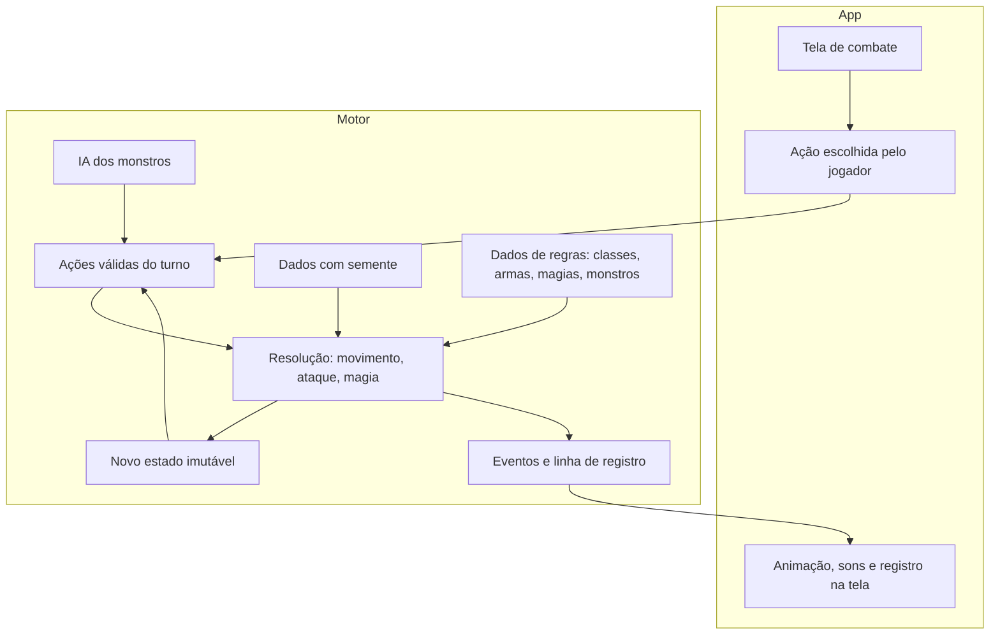

# Delve Ever After

RPG tático cooperativo para celular, de expedições curtas a masmorras, com combate por turnos em um tabuleiro de casas.

## A ideia

O jogo leva a mecânica de um RPG de mesa para partidas curtas no celular, com o celular na vertical. Cada combate acontece num tabuleiro pequeno, com poucas decisões por turno e efeito claro em cada uma.

O público é quem conhece RPG de mesa e quer partidas rápidas no celular. O desenho prevê de 1 a 5 jogadores no mesmo grupo.

A base de regras é o System Reference Document 5.1 (SRD 5.1), sob a licença Creative Commons Attribution 4.0 International (CC-BY 4.0). As regras foram adaptadas ao formato: alcances medidos em casas, uma criatura por casa e áreas de efeito desenhadas sobre a grade.

This work includes material taken from the System Reference Document 5.1 ("SRD 5.1") by Wizards of the Coast LLC and available at https://dnd.wizards.com/resources/systems-reference-document. The SRD 5.1 is licensed under the Creative Commons Attribution 4.0 International License available at https://creativecommons.org/licenses/by/4.0/legalcode.

## Estado atual

Já funcionam:

- o motor de regras, com combate completo, cinco classes, magias, condições, monstros e inteligência artificial (IA) para os inimigos;
- masmorras com desafios fora do combate e progressão de personagem;
- um app que roda essas partes no navegador e foi empacotado como APK de teste para Android, em modo solo.

A grade nova de 5 × 6 casas, com terreno, cobertura e a ação de se esconder, já roda no motor, mas ainda não está no app.

Ainda não existem o multijogador em rede e a publicação em loja. A arte está em desenvolvimento, e por isso esta vitrine não traz telas.

## Como funciona o motor

O motor é separado da interface e não depende de nada externo para rodar. O app só mostra o que o motor decide.

**Regras.** As regras ficam em arquivos de dados: classes, armas, magias, monstros, encontros e masmorras. As constantes de equilíbrio têm nome e um comentário com o motivo.

**Turno.** Cada criatura tem movimento, ação, ação bônus e reação. Num turno, o motor:

1. calcula as ações válidas;
2. aplica a ação escolhida;
3. rola os dados;
4. resolve acerto, dano, condições e reações, como o ataque de oportunidade;
5. gera eventos estruturados e uma linha de registro em português.

**Cooperação.** Cada combate recebe a lista de personagens controlados por pessoas. Os demais heróis e os monstros são controlados pela IA, então o mesmo motor serve para um jogador sozinho ou para um grupo.

**Determinismo.** Os dados vêm de um gerador com semente, e o estado nunca é alterado no lugar. O combate em andamento é guardado como uma lista de comandos. Com a mesma semente e os mesmos comandos, o resultado é sempre o mesmo.

**Testabilidade.** Isso permite testar regra por regra com dados roteirizados. Também permite simular centenas de combates por cenário para medir taxa de vitória e duração, com intervalo de confiança.

## Um turno resolvido



Abaixo, um turno real resolvido pelo motor na grade 5 × 6, com semente 7. Os nomes foram trocados por nomes genéricos; os números e a ordem dos eventos são os que o motor gerou. Rodar de novo com a mesma semente dá o mesmo resultado.

**Estado inicial.** Brann (guerreiro) está na coluna 3, fileira 2, com 28 PV e CA 18. O Saqueador (criatura de linha de frente) está na coluna 3, fileira 4, com 15 PV e CA 13.

**Iniciativa.** Brann rolou 13 + 2 = 15. O Saqueador rolou 11 + 1 = 12. Brann age primeiro.

**Ações escolhidas.** Brann se move uma casa, para a coluna 3, fileira 3, e fica vizinho do Saqueador. Depois ataca com a espada longa.

**Rolagens e resultado.**

- **Ataque de Brann:**
  - d20 = 15, mais o bônus de ataque de 5, dá 20 contra CA 13: acerto.
  - Dano: d8 = 7, mais o bônus de 5, dá 12. O Saqueador fica com 3 PV.
- **Turno do Saqueador (IA):** ele já está vizinho, então ataca sem se mover.
  - d20 = 16, mais o bônus de ataque de 5, dá 21 contra CA 18: acerto.
  - Dano: d12 = 9, mais o bônus de 3, dá 12. Brann fica com 16 PV.

**Registro gerado:**

```
Rodada 1
Guerreiro Brann se move para a coluna 3, fileira 3.
Guerreiro Brann ataca Saqueador com Espada longa: 20 contra CA 13, acerta e causa 12 de dano.
Saqueador ataca Guerreiro Brann com Machado grande: 21 contra CA 18, acerta e causa 12 de dano.
```

## Como foi construído

Eu defino o produto: o que é o jogo, quais regras entram e como se adaptam, o que vai para cada etapa e quando algo está bom ou precisa voltar. Também jogo as versões de teste e registro as críticas que viram as próximas tarefas.

O desenvolvimento roda num ciclo que eu montei para os meus projetos, com agentes de IA em papéis separados:

1. **Tarefas.** Cada decisão vira uma tarefa de até cerca de duas horas. Ela tem objetivo, escopo, o que fica de fora e critérios verificáveis. Junto vai um arquivo de teste de aceitação, escrito antes da implementação.
2. **Implementação isolada.** O agente executor trabalha numa cópia separada do repositório e não pode alterar os testes de aceitação.
3. **Testes.** Uma validação automática roda todos os testes, o build e um verificador de vazamento de dados. Se algo falha, a tarefa volta ao executor.
4. **Revisão.** Dois agentes revisores, de modelos diferentes, leem a entrega, com até três rodadas por tarefa. Aprovada, a tarefa entra na branch principal sem commit manual.

## Números

Medidos no repositório e nos registros do ciclo:

- **Período:** de 21/10/2026, data do primeiro commit, a 13/11/2026, data da última tarefa entregue.
- **Commits:** 273 na branch principal.
- **Tarefas concluídas:** 85 (uma tarefa especificada foi cancelada antes de começar).
- **Testes:** 926 em 136 arquivos, na validação da última tarefa. Desses arquivos, 85 são testes de aceitação, um por tarefa.

## Decisões relevantes

1. **Motor determinístico e separado da interface.** Assim cada combate pode ser reproduzido num teste, simulado em lote e retomado a partir da lista de comandos.
2. **Regras como dados, com as constantes de equilíbrio nomeadas.** Assim o equilíbrio é ajustado pelos resultados de simulação sem mexer na lógica.
3. **Teste de aceitação escrito antes de cada tarefa e bloqueado para quem implementa.** Assim o que conta como pronto fica definido antes do código, e cada tarefa entregue vira teste de regressão.
4. **Tabuleiro pequeno, em casas, com uma criatura por casa.** Isso cabe na tela do celular na vertical e mantém poucas opções por turno, com alcances e áreas fáceis de ler.
5. **Troca do tabuleiro de 6 × 3 para 5 × 6 introduzida como opção.** O tabuleiro antigo continuou o padrão até a simulação comparar os dois formatos em taxa de vitória, duração e ataques de oportunidade. Nada que já funcionava quebrou.

## Tecnologia

TypeScript (motor e app sem framework), Vitest para testes e Capacitor para empacotar o app para Android.

## Sobre o código

O repositório do projeto é privado; este repositório é a vitrine pública.
